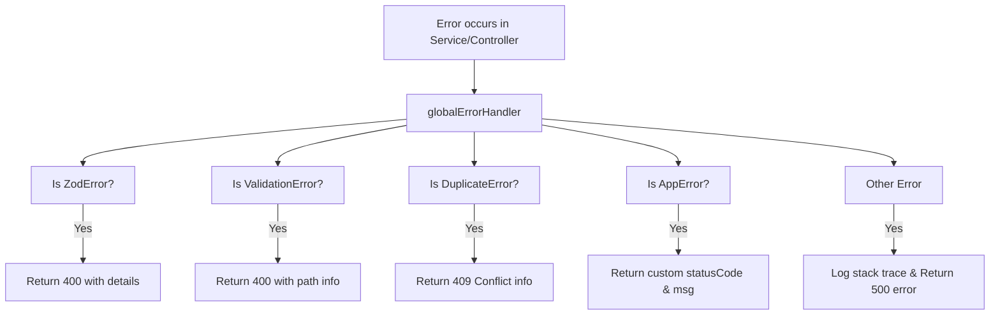

# API Design & Response Guidelines

This document outlines the API guidelines, request/response formats, validation schemas, error handling conventions, and versioning standards for the Deenindunya API.

---

## 1. Request and Response Formats

All API endpoints must conform to a standardized JSON communication contract.

### Successful Response Format
All successful responses must utilize the `sendResponse` helper from [sendResponse.ts](file:///d:/bd-calling/task/backend-deenduniya/server/src/app/utils/sendResponse.ts):

```typescript
type TResponse<T> = {
  statusCode: number;
  success: boolean;
  message?: string;
  meta?: any;
  data: T;
}
```

**JSON Example:**
```json
{
  "success": true,
  "statusCode": 200,
  "message": "User profiles retrieved successfully.",
  "meta": {
    "page": 1,
    "limit": 10,
    "total": 45,
    "totalPage": 5
  },
  "data": [
    {
      "id": "60d0fe4f5311236168a109ca",
      "email": "user@example.com",
      "role": "user"
    }
  ]
}
```

---

## 2. API Versioning

API endpoints are strictly versioned.
- Routes are registered in [server/src/app/routes/index.ts](file:///d:/bd-calling/task/backend-deenduniya/server/src/app/routes/index.ts).
- Client endpoints are prefixed with `/api/v1` (e.g., `/api/v1/auth/login`).

---

## 3. Error Handling Flow (`AppError` & Global Middleware)

Error handling is automated via Express middleware to guarantee that internal code leaks do not expose details to clients.



### Global Error Payload Format
When an error is thrown, the API returns a structured error object containing:
- `success`: Always `false`.
- `statusCode`: HTTP Status Code.
- `message`: User-friendly simplified error message.
- `errorSources`: Array containing structural elements describing the error location (`path` and `message`).
- `stack`: Included only when `NODE_ENV=development`.

**Example Error Output:**
```json
{
  "success": false,
  "statusCode": 400,
  "message": "Invalid password length",
  "errorSources": [
    {
      "path": "password",
      "message": "Password must be at least 6 characters long"
    }
  ],
  "stack": "Error: Invalid password length\n    at..."
}
```

### Throwing Errors
When throwing manual errors within Services or Controllers, developers **must** use the `AppError` class:

```typescript
import httpStatus from 'http-status';
import AppError from '../errors/AppError';

// In service logic
throw new AppError(
  httpStatus.BAD_REQUEST, 
  'Resource modification rejected.'
);
```

---

## 4. Input Validation (Zod Validation)

Validation must happen at the router entry boundary.

- **Middleware**: `validateRequest.ts` wraps the Zod schema checks.
- **Scope**: The validator extracts and checks `body`, `params`, `query`, and `cookies`.

**Routing integration:**
```typescript
import { Router } from 'express';
import validateRequest from '../middleware/validateRequest';
import { UserValidation } from './user.validators';

const router = Router();
router.post(
  '/update-profile',
  validateRequest(UserValidation.updateProfileSchema),
  UserController.updateProfile
);
```
