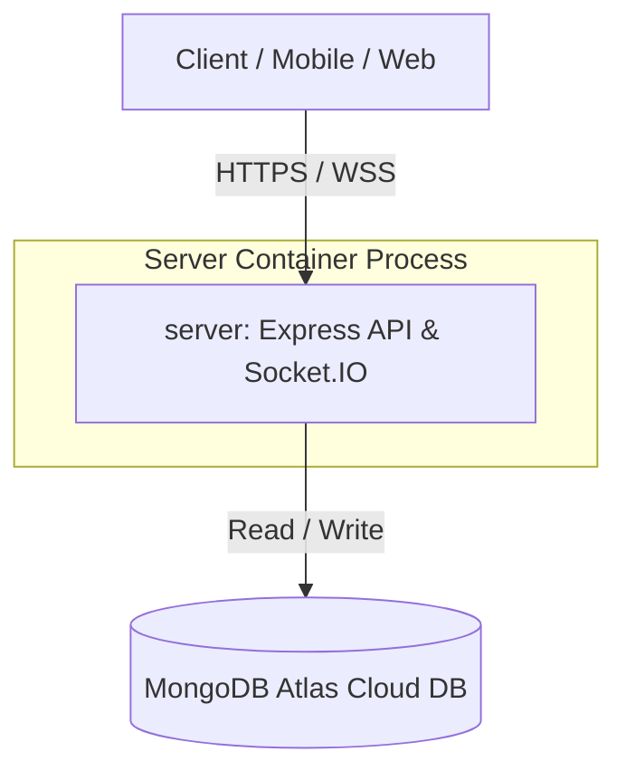
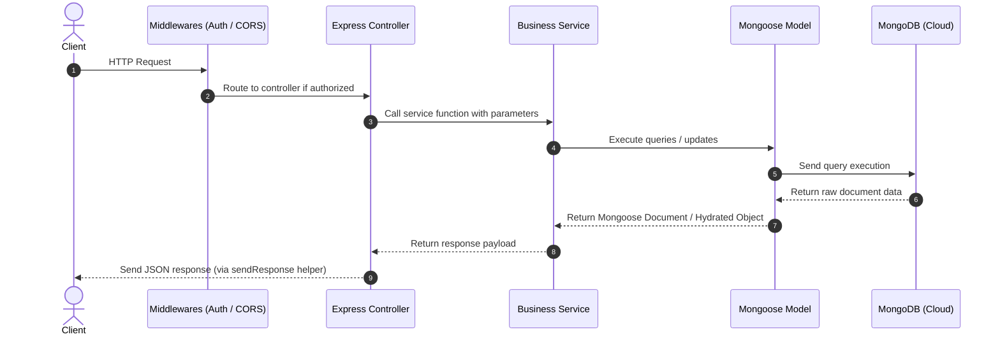

# Deenindunya Backend - System Architecture

This document describes the layered architecture and service data flows of the Deenindunya backend application.

---

## 1. High-Level System Overview

The system consists of the client (mobile/web applications), an Express API server hosting Socket.IO events, and a MongoDB Atlas cloud database instance:

- **API Server**: An Express server running on port `5024` that exposes versioned API endpoints (`/api/v1`).
- **Real-time Server**: A Socket.IO listener running on port `4024` that handles persistent WebSocket connections.
- **Database**: MongoDB Atlas cloud cluster connected using Mongoose.

---

## 2. Layered Application Architecture (Server)

The Express application inside `server/src` follows a clean separation of concerns using a layered pattern:

### Key Architectural Layers

#### 1. Routing & Middleware Layer
- **Entrypoints**: Defined inside [server/src/app/routes/index.ts](file:///d:/bd-calling/task/backend-deenduniya/server/src/app/routes/index.ts).
- **Middlewares**: Handles global concerns like CORS, cookie parsing, route authentication validation, and centralized error catching using `globalErrorHandler.ts`.

#### 2. Controller Layer
- **Responsibility**: Manages the HTTP request/response cycle.
- **Functionality**: Extracts request body, parameters, and query parameters, and coordinates with services.

#### 3. Service Layer
- **Responsibility**: Contains business logic, calculations, integration with third-party APIs (Stripe, Firebase, AWS S3, Nodemailer), and DB manipulation orchestration.

#### 4. Model / Schema Layer
- **Responsibility**: Defines database schemas, validations, and helper methods.
- **Location**: Defined within domain modules inside `server/src/app/modules/<module>/*.model.ts`.
