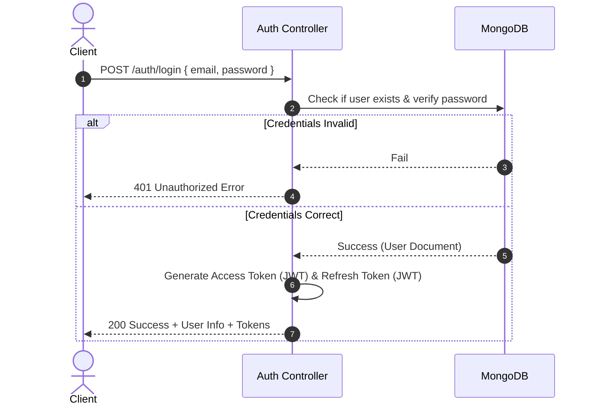

# Authentication & Session Management

This document defines the authentication flow, session patterns, JWT policies, password procedures, and role-based access control (RBAC) in the Deenindunya backend application.

---

## 1. Authentication Flow

The system supports email-based authentication and credentials checking using JWT tokens:



---

## 2. JWT Access & Refresh Token Management

Tokens are issued at login/registration and validated per request:
1. **Access Token**:
   - Short-lived JSON Web Token.
   - Passed by the client in the `Authorization` header.
   - Verifies the user's role and email payload using `JWT_ACCESS_SECRET`.
   - Validated via the [auth.ts](file:///d:/bd-calling/task/backend-deenduniya/server/src/app/middleware/auth.ts) middleware.
2. **Refresh Token**:
   - Long-lived JSON Web Token.
   - Sent to the token refresh endpoint to issue a new Access Token.
   - Verifies ownership and updates credentials using `JWT_REFRESH_SECRET`.

---

## 3. Role-Based Access Control (RBAC)

Authorization is managed declaratively inside routes using the `auth` middleware, matching against required roles (e.g. `USER`, `ADMIN`):

```typescript
import { Router } from 'express';
import auth from '../middleware/auth';
import { USER_ROLE } from '../modules/user/user.constant';

const router = Router();

// Route restricted to admin users only
router.post(
  '/admin/settings',
  auth(USER_ROLE.ADMIN),
  AdminController.updateSettings
);

// Route accessible by multiple roles
router.get(
  '/dashboard',
  auth(USER_ROLE.ADMIN, USER_ROLE.USER),
  DashboardController.getOverview
);
```

### Safety and Block Checks
Inside the `auth` middleware, the following safety gates are verified:
- **Existence Check**: Verifies that the user still exists in the database.
- **Deletion Check**: Blocks the request immediately if `user.isDeleted` is set to `true` (returns `403 Forbidden`).
- **Block Status**: Checks `user.status === 'blocked'` (returns `403 Forbidden`).
